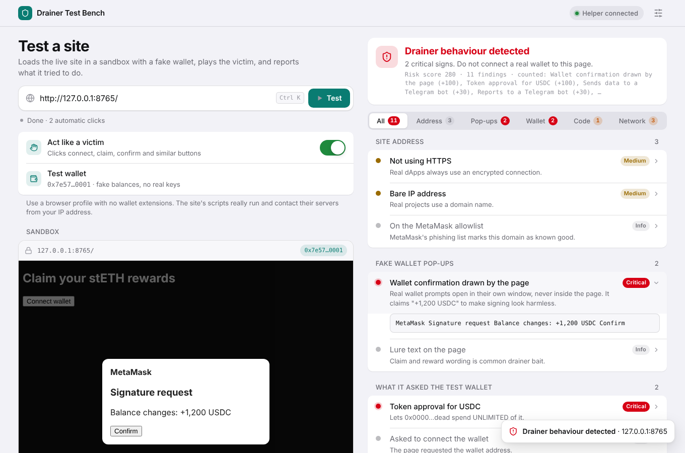

# Drainer Test Bench

Check whether a website tries to drain crypto wallets before you connect a real one.

Drainer Test Bench loads a live site into a sandbox, gives it a fake "honeypot" wallet that holds no real keys, plays the victim by clicking Connect, Claim and Confirm, and reports what the site tried to do:

- **Fake wallet pop-ups**: wallet confirmation boxes drawn inside the page (real wallet prompts always open in their own window), fake browser windows, and recovery-phrase forms.
- **What it asked the wallet to sign**: Permit and Permit2 signatures, Seaport orders, token and NFT approvals and transfers, decoded into plain words such as "lets 0xdead… move USDT, USDC and WETH, unlimited".
- **Red flags in the code**: known drainer infrastructure, Telegram reporting, the StepDrainer `-.php` logging pattern, drainer kit names, obfuscation and anti-debugging tricks, in the page and in every script file it loads.
- **Where it tried to send data**, including whether it leaked the wallet address to another domain.
- **Malicious JavaScript** (own score): packed or JSFuck-encoded code, runtime-downloaded code, cryptominers, clipboard hijackers that swap a copied wallet address, keyloggers and card skimmers, hidden iframes, Discord webhooks, bare-IP connections and script hosts from known supply-chain attacks such as polyfill.io.
- **Privacy** (own A–F score): every cookie the site sets (header or script, first or third party, lifetime, tracking names), trackers by kind (ads, analytics, session recording, social, fingerprinting), canvas, font, audio and WebGL fingerprinting, keystroke listeners from third parties, 1-pixel tracking images and the number of other domains contacted.
- **The site address**: MetaMask's phishing blocklist, look-alike domains of about 25 popular projects, lure words and throwaway hosting.

Building blocks every DEX uses (Permit2, unlimited approvals to Permit2, Uniswap routers) are listed for context and do not count against a site.



## Quick start

Requires Python 3.8 or newer. No packages to install.

```sh
python3 drainer-bench.py
```

It opens the bench at `http://127.0.0.1:8787/`. **Use a browser profile with no wallet extensions installed.** The tested site's scripts really run and contact their servers from your IP address. If a wallet extension reaches into the sandbox, the bench stops the test.

Enter a site address and press **Test**.

Options:

| Flag | What it does |
| --- | --- |
| `--port 8787` | Port for the bench. The site under test uses the next free port. |
| `--allow-private` | Allow addresses on your local network, for testing your own local dApp. |
| `--no-browser` | Don't open the browser automatically. |

## How it works

```
 browser                                     drainer-bench.py (127.0.0.1 only)
 ┌────────────────────────────┐              ┌──────────────────────────────────┐
 │ bench page   :8787         │── stage ───▶ │ bench server: page, keyed fetch  │
 │   └─ iframe  :8788 (site)  │              │ site server: staged page + relay │──▶ the real site,
 │       honeypot wallet      │── every ───▶ │   (requests, headers, WebSockets)│    its CDN and APIs
 │       service worker relay │   request    └──────────────────────────────────┘
 └────────────────────────────┘
```

- The bench and the site under test run on **different local origins** (`:8787` and `:8788`), so the tested site cannot read or control the bench.
- A service worker routes every request the site makes through the helper, which presents the site's real address as `Origin` and `Referer`. Script files, API calls and WebSockets load as they would on the real site.
- A small script injected before the site's own code installs the honeypot wallet (as `window.ethereum` and through EIP-6963), records wallet requests and network attempts, watches for fake wallet pop-ups, and clicks through the site like a victim.
- The helper downloads every script file the site loads, and the bench scans them.

### Helper safety rules

- Listens on `127.0.0.1` only.
- The bench's own fetch route needs a random key that only the bench page knows; requests from other origins, including the sandboxed site, are refused.
- Refuses addresses on your local network (router, NAS, cloud metadata, the helper itself) unless you pass `--allow-private`. The helper's own ports stay blocked either way.
- Sends no cookies to the tested site and keeps none from it.

## Limits

- A clean result means "nothing seen", not "safe". Kits can hide when they detect a sandbox, a fake wallet, an empty balance or a test address.
- The site runs at a local test address, so sites that check their own address or block unknown visitors may behave differently.
- Drainers also abuse your real wallet's genuine prompts. Always read the request in your wallet's own window before signing.
- The malicious-code and privacy scores are heuristics from one page load. Pages behave differently after consent banners, logins and scrolling, and a low risk or high privacy score is not a guarantee. Cookies and background requests are visible only through the local helper.
- The tracker list is a short built-in one. It does not cover every tracker.
- Contract names (Permit2, Uniswap routers) and token names are recognized on Ethereum mainnet addresses.

## Project layout

```
drainer-bench.py         single-file app users run (generated by build.py)
build.py                 embeds src/bench.html into src/helper.py
src/bench.html           the bench page: UI, honeypot wallet, analysis rules
src/helper.py            local server: bench page, site relay, WebSocket tunnel
```

## Development

Edit `src/bench.html` and `src/helper.py`, then rebuild:

```sh
python3 build.py
```

## Contributing

Issues and pull requests are welcome. Detection rules live in `src/bench.html` (`STATIC_RULES`, `analyzeTyped`, `analyzeCall`, `analyzeNet` and the pop-up scanner in `harness`). Keep legitimate DEX building blocks (Permit2, Uniswap routers) from being flagged when you add a rule.

## Security

See [SECURITY.md](SECURITY.md) for how to report a vulnerability.

## License

[MIT](LICENSE). Third-party material is listed in [THIRD_PARTY_NOTICES.md](THIRD_PARTY_NOTICES.md).

This project is a defensive tool provided as is, without warranty. It is not financial or security advice.
